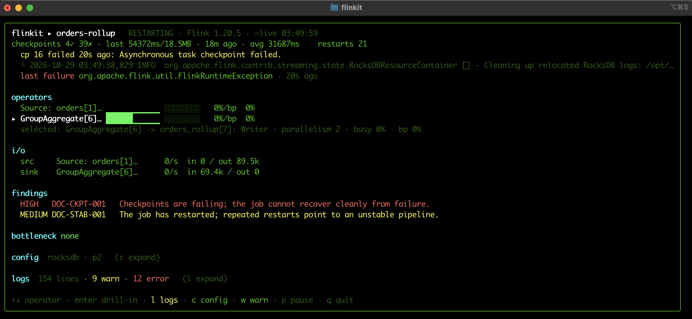
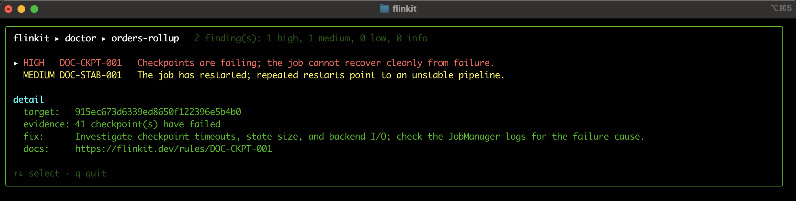

# try-flinkit

**See [flinkit](https://flinkit.dev) diagnose a real, misbehaving Apache Flink job in about five minutes — on your laptop, with Docker.**

flinkit is a vendor-neutral CLI for triaging Flink jobs: it reads a running
job over the JobManager REST API and tells you *what's wrong and why* —
backpressure and its root cause, checkpoint failures, state growth, consumer
lag, and risky configuration — without you clicking through the Flink web UI.

This repo spins up a local Flink cluster and submits a deliberately
load-stressed job so you can point flinkit at it and watch it work.

---

## Prerequisites

- **Docker** (with Compose v2 — `docker compose`, not `docker-compose`).
- **flinkit** on your `PATH`. It's currently a licensed tool — see
  [Getting flinkit](#getting-flinkit) below.

## Quickstart

`make` just manages the local Flink cluster (Docker). You run **flinkit itself
directly** — that's the whole point of the demo.

```sh
git clone https://github.com/smanjakuppam-at-s3i/try-flinkit
cd try-flinkit

make up        # start the Flink cluster  (web UI: http://localhost:8081)
make submit    # submit the example job

# Point flinkit at this repo's config (once per shell) so it finds the cluster:
export FLINKIT_CONFIG=$PWD/flinkit.config.yaml

flinkit scan                            # list the job
flinkit inspect orders-rollup --watch   # live triage (the main event; by name or id)
flinkit doctor                          # ranked health findings
```

When you're done:

```sh
make down      # stop the cluster and wipe its state
```

> `FLINKIT_CONFIG` points flinkit at this repo's
> [`flinkit.config.yaml`](flinkit.config.yaml) (a `local-oss` profile →
> `localhost:8081`), so the demo never touches your own
> `~/.flinkit/config.yaml`. Prefer not to export it? Prefix a command instead:
> `FLINKIT_CONFIG=$PWD/flinkit.config.yaml flinkit scan`.

## What you'll see

The example job ([`jobs/slow-aggregation.sql`](jobs/slow-aggregation.sql)) runs a
high-cardinality 5-second tumbling aggregation fed by `datagen` at 200k rows/sec
on a **deliberately small TaskManager**. It builds more RocksDB state than it can
checkpoint in time, so it **fails its checkpoints and restart-loops** — a common,
realistic "under-provisioned streaming job" failure that flinkit explains:

- **`inspect`** — a live dashboard: climbing checkpoint failures and restart
  count, the checkpoint-failure reason with a correlated log line, the last
  failover exception, and the findings called out inline. (`bottleneck: none` —
  the job isn't backpressured; its problem is checkpointing, not throughput.)
- **`doctor`** — ranks the findings: `HIGH DOC-CKPT-001` (checkpoints failing,
  the job can't recover) and `MEDIUM DOC-STAB-001` (repeated restarts), each with
  evidence, a fix, and a docs link.

### Screenshots

> _Captured from a live run — see [`screenshots/`](screenshots/)._

| `flinkit inspect orders-rollup --watch` | `flinkit doctor` |
|---|---|
|  |  |

For a narrated, step-by-step tour of what each panel is telling you, read
**[walkthrough.md](walkthrough.md)**.

## Getting flinkit

flinkit is in private beta. If you have access, install it from the private
Homebrew tap (you'll need a GitHub token that can read the repos):

```sh
export HOMEBREW_GITHUB_API_TOKEN=<your token>
brew install smanjakuppam-at-s3i/tap/flinkit
```

Interested in access? Reach out at **hello@flinkit.dev**.

## License

The contents of this demo repo are licensed under [Apache-2.0](LICENSE).
Apache Flink is a trademark of the Apache Software Foundation.
